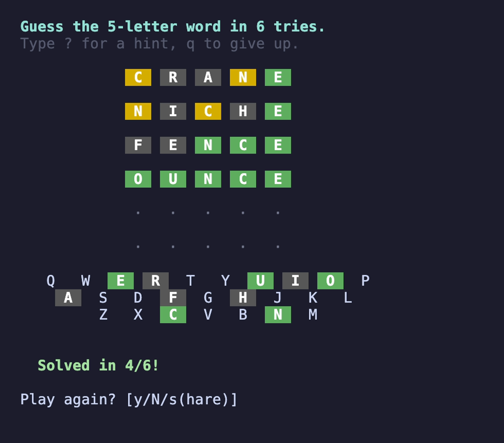
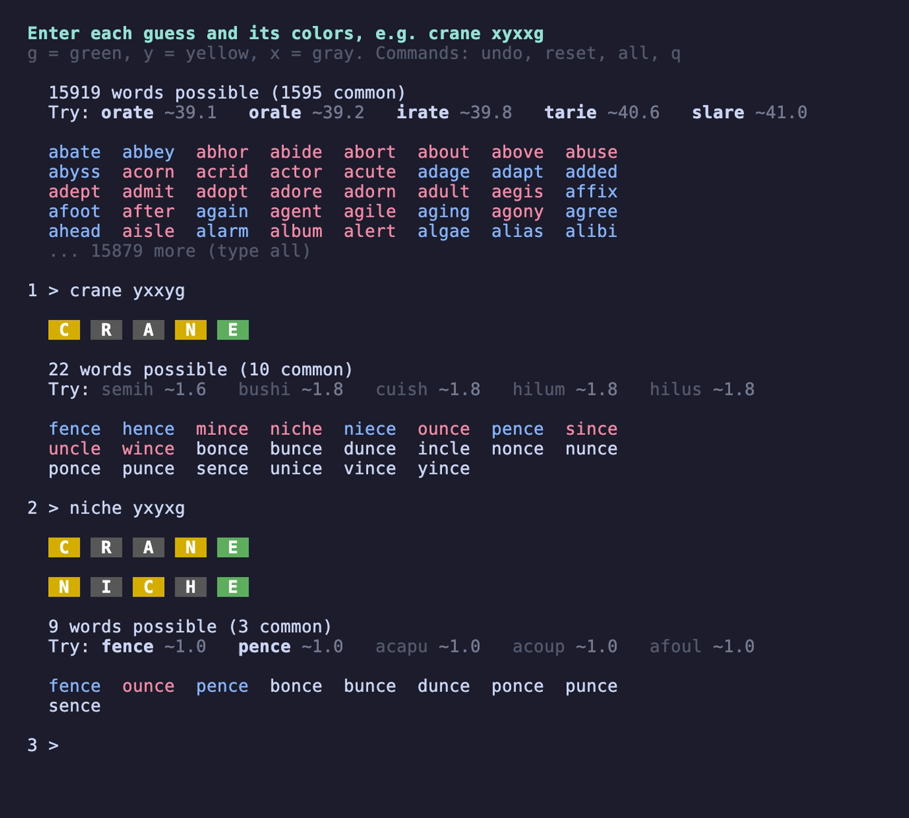

# Ruby-Wordle

Play Wordle and solve Wordle on the command line

⬜️⬜️⬜️⬜️⬜️ \
⬜️⬜️⬜️🟨🟨 \
⬜️🟩⬜️🟩⬜️ \
🟩🟩⬜️🟩🟩 \
🟩🟩🟩🟩🟩

----

### Installation

Requires Ruby 3.2 or later.

```
gem install ruby-wordle
```

----

### Play Wordle

```
ruby-wordle play
```



Guess the 5-letter word in 6 tries. After each guess, the board shows each letter on a green tile (right place), a yellow tile (in the word, elsewhere) or a gray tile (not in the word, or already marked as many times as it occurs), and the keyboard below it shows the best color found for every letter so far. On a terminal, the board is updated in place; when the output below it no longer fits on the screen, the window is resized, or the input has non-ASCII characters, a new board is printed below instead.

| Input | Action |
| --- | --- |
| a 5-letter word | Make a guess |
| `?` | Show how many common words still fit your guesses |
| `hint letter` | Reveal the letter at the first position not yet guessed correctly (once per game, and only while at least two such positions remain) |
| `q` | Give up and show the answer |

After a game with at least one guess, type `s` at the `Play again?` prompt to copy the result as emoji squares (🟩🟨⬛) to the clipboard, ready to paste into a post. Hints do not use up a guess, but a game with hints is marked `(assisted)` in the result and the copied text. A letter hint can still be enough to work out the word. Where no clipboard command is available (`pbcopy`, `wl-copy`, `xclip` or `xsel`), the result is printed instead.

Answers are picked from a list of about 1,600 common words. Guesses are accepted from a list of about 16,000 words.

----

### Wordle Solver

```
ruby-wordle solve
```

Enter each guess you made in a Wordle game together with the colors it got, one character per letter: `g` green, `y` yellow, `x` gray (`2`, `1`, `0` also work).

```
1 > crane yxxyg
2 > niche yxyxg
```



After each line, the solver shows how many words are still possible, the best next guesses, and the possible words, grouped into common words from the basic word list and other words. Every listed word fits the colors. On a terminal, the turns and the possible words are updated in place, as in the game. When a guess gets all green, the solver asks whether to solve another.

The next guesses are ranked by the expected number of common words left after playing them (shown as `~3.8`). Words that can still be the answer are in bold; the others are in gray (marked `(probe)` without colors) and are good for narrowing down the answer but cannot be it.

| Input | Action |
| --- | --- |
| `GUESS COLORS` | Add a turn, e.g. `crane xyxxg` |
| `undo` | Remove the last turn |
| `reset` | Start over |
| `all` | List every possible word |
| `q` | Quit |

To get the result without prompts, pass the turns as arguments:

```
ruby-wordle solve crane:xxxxx pilot:yygxy
```

----

### Colors

Colors are off when the output is not a terminal, when `NO_COLOR` is set to a non-empty value, or with `--no-color`. Without colors, `[A]` is green, `(A)` is yellow and a lowercase letter is gray.

----

### Word Lists

The 5-letter lists used by the game and the solver are in `word-lists/5-letters`:

| File | Contents |
| --- | --- |
| `word-list.txt` | All 5-letter words (accepted guesses) |
| `word-list-uniq-letters.txt` | All 5-letter words with five different letters |
| `word-list-basic.txt` | Common 5-letter words (answers) |
| `word-list-basic-uniq-letters.txt` | Common 5-letter words with five different letters |

They are generated from two source lists in the repository:

- `word-lists/word-list-original.txt`: about 370,000 English words, based on `words_alpha.txt` in [dwyl/english-words](https://github.com/dwyl/english-words)
- `word-lists/word-list-basic.txt`: about 13,000 basic English words

Only alphabetic words are kept, and capitalized entries in the basic list (proper nouns) are left out of the common words. To generate lists of another length into `word-lists/N-letters`, run in a clone of the repository:

```
bundle install
bundle exec rake wordlists LENGTH=6
```

----

### Development

```
bundle install
bundle exec rake test
```

Every tracked file must match a line of `script/tracked_paths.allow`. To check it before each commit and push, run `ln -s ../../script/hooks/pre-commit ../../script/hooks/pre-push .git/hooks/`.

The screenshots in `img/` are recorded from `img/*.tape` with `bundle exec rake screenshots`, which requires [VHS](https://github.com/charmbracelet/vhs) and ttyd.

----

### Author

Yoichiro HASEBE

----

### License

MIT
